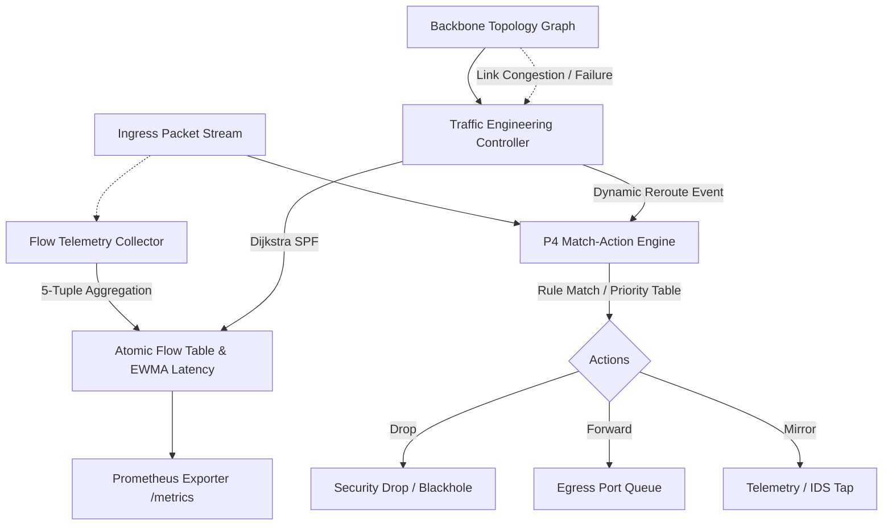

# rust-sdn-p4-flow-telemetry-engine

[](https://github.com/FelipeMadson/rust-sdn-p4-flow-telemetry-engine/actions)
[](LICENSE)
[](https://www.rust-lang.org/)
[](Cargo.toml)

> High-Performance Software-Defined Networking (SDN) & P4 Match-Action Pipeline Engine, Autonomous Dijkstra Traffic Engineering, and Line-Rate Telemetry Collector implemented in 100% pure, safe Rust with zero external dependencies.

Developed by **[Felipe Madison](https://github.com/FelipeMadson)** to serve as an open-source reference implementation for national research backbones (such as RNP Ipê), cloud-scale edge networks, and programmable data plane environments.

---

## 🚀 Key Architectural Highlights

1. **Programmable P4 & OpenFlow Match-Action Pipeline**:
   - Supports **Exact Match** (e.g. L4 protocol, ingress port), **Longest Prefix Match (LPM)** with bitwise subnet masking, and **Ternary TCAM Wildcards**.
   - Rule evaluation ordered by descending priority with atomic packet and byte counters (`AtomicU64`).
   - Actions include `Forward`, `Drop`, `MirrorAndForward`, and `SetDstPort`.

2. **Autonomous Dijkstra Traffic Engineering & Dynamic Rerouting**:
   - Models national optical/SDN topologies (such as the RNP Brazilian academic backbone PoPs: DF, SP, RJ, CE, RS).
   - Computes composite-cost **Shortest Path First (SPF)** incorporating base optical latency and link congestion penalties.
   - Detects link failures and triggers autonomous flow rerouting to alternate paths when link saturation exceeds 85%.

3. **Line-Rate Flow Telemetry Accounting**:
   - Real-time 5-tuple tracking (`src_ip`, `dst_ip`, `src_port`, `dst_port`, `protocol`).
   - Tracks packet volume, byte throughput, and Exponential Weighted Moving Average (EWMA) flow latency.
   - Native Prometheus metric exposition endpoint (`/metrics`) for Grafana integration.

4. **Pure Safe Rust with Zero External Crates**:
   - Eliminates supply-chain vulnerabilities and guarantees sub-second compilation and deterministic execution across Linux, macOS, and Windows.
   - Built-in lightweight HTTP REST daemon using `std::net::TcpListener`.

---

## 🏛️ System Architecture



---

## 🛠️ Verification & Test Suite

Run the full automated test suite using Cargo:

```bash
cargo test --verbose
```

### Passing Tests

```text
running 2 tests
test test_p4_match_action_lpm_and_exact ... ok
test test_telemetry_flow_aggregation_and_prometheus_export ... ok

running 2 tests
test test_topology_dijkstra_spf_shortest_latency ... ok
test test_autonomous_rerouting_on_link_failure_and_congestion ... ok
```

---

## 📡 REST Daemon Endpoints

When running `cargo run`, the daemon listens on `http://127.0.0.1:8087`:

- `GET /health` — Health status check.
- `GET /metrics` — Native Prometheus metric stream.
- `GET /api/v1/topology` — Real-time backbone topology node count, link capacity, and operational status.

---

## 📜 License

MIT License. Designed and maintained by [Felipe Madison](https://github.com/FelipeMadson).
